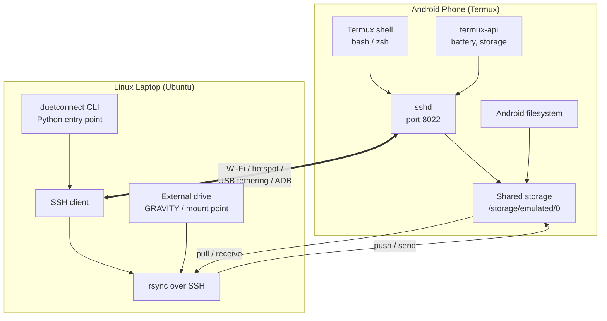
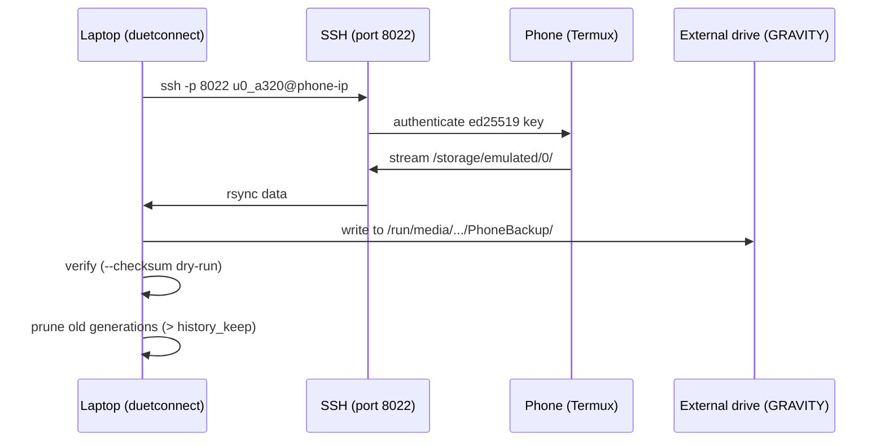
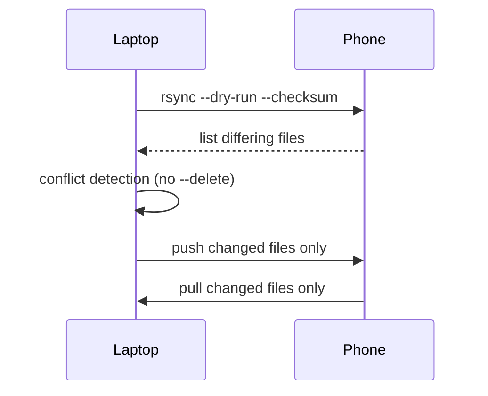
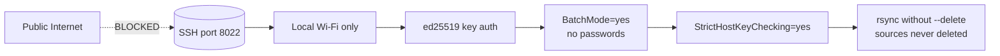

# Duet Connect Architecture

## System overview



## Module map

```mermaid
graph LR
    subgraph CLI["CLI layer (argparse)"]
        C1[status] --> C2[connect]
        C2 --> C3[send / receive]
        C3 --> C4[backup]
        C4 --> C5[sync]
        C5 --> C6[battery / storage / doctor]
    end

    subgraph Core["Core orchestrators"]
        M1[config.py] --> M2[ssh.py]
        M2 --> M3[transfer.py]
        M3 --> M4[backup.py]
        M4 --> M5[remote.py]
        M5 --> M6[health.py]
    end

    subgraph System["System tools (no reinvention)"]
        S1[ssh / ssh-keygen / ssh-keyscan]
        S2[rsync --partial --progress]
        S3[ping / ssh-keyscan]
        S4[termux-api (optional)]
    end

    CLI --> Core
    Core --> System
```

## Data flow — backup (phone → laptop external drive)



## Data flow — sync (bidirectional)



## Security boundary



## Design principles

| Principle | How it's implemented |
|-----------|---------------------|
| **No root on Android** | Uses Termux user space; `sshd` runs as unprivileged app user |
| **Stateless** | Each CLI call opens its own SSH connection; nothing stays open |
| **No passwords** | ed25519 keys only; `BatchMode=yes` blocks interactive prompts |
| **No source deletion** | rsync invoked without `--delete`; copies only, never removes |
| **Configurable** | Every machine-specific value in `duetconnect.cfg` (users, ports, drive, subnet) |
| **Standard tools** | Built on ssh, rsync, ssh-keygen, ping — no heavy frameworks |

## Limitations

- Phone IP is dynamic — `duetconnect doctor` re-discovers it each run
- Only shared storage (`/storage/emulated/0`) is rsync-accessible. App-private data
  (WhatsApp databases, video vaults, download manager caches) must be exported
  through the app itself before a factory reset
- Termux:API commands (`termux-battery-status`) require the `termux-api` package

---

**Next:** [Usage examples →](USAGE.md)
